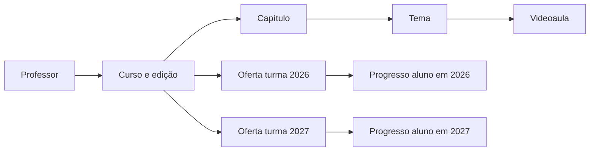

> Atualização: o diário por turma/ano/período e a revisão dos vínculos antigos já estão implementados. Consulte [o guia atualizado](DIARIO_E_RECONCILIACAO.md). As limitações de notas descritas abaixo correspondem à entrega inicial dos cursos.

# Cursos reutilizáveis e gestão acadêmica

Implementação de 23/10/2026. Este documento atualiza as decisões do planejamento inicial em PLANEJAMENTO_EVOLUCAO_CURSOS.md.

## Usar o mesmo material em vários anos

O curso é uma biblioteca independente da turma e do ano letivo. Um professor responsável organiza capítulos, temas e videoaulas. A administração publica o material e libera ofertas para as turmas. Cada oferta aponta para o mesmo curso: as aulas não são copiadas para cada turma.

Exemplo: o curso Álgebra pode ser usado na turma A de 2026, turma B de 2026 e turma A de 2027. O aluno mantém um progresso separado em cada oferta. Uma conclusão em 2026 não conclui automaticamente o curso de 2027.

Cursos publicados são imutáveis. Para alterar o material, o professor usa **Duplicar para nova edição**. A cópia recebe novos capítulos, temas e aulas, permanece em rascunho e não recebe matrículas, ofertas nem progresso. A edição anterior continua atendendo às suas turmas. Uma disciplina pode ter vários cursos/edições; isso substitui a limitação de um curso por disciplina do plano inicial.

## Fluxo de uso

1. Administração cadastra pessoas e disciplinas pelas telas existentes.
2. Em **Gestão acadêmica** (`/admin/gestao-turmas`), cria a turma com ano e código, atribui professor + disciplina + turma e matricula os alunos. Um professor pode receber várias combinações.
3. Professor abre **Biblioteca de cursos** (`/cursos`), escolhe uma disciplina à qual está vinculado e cria o rascunho. Na primeira versão há um professor responsável por curso; coautoria não está incluída.
4. Professor adiciona capítulos, temas e aulas. Pode editar, remover itens vazios e reordenar antes da publicação. A administração também pode editar rascunhos.
5. Administração abre o curso, revisa a prévia e publica. Todos os capítulos precisam ter temas e todos os temas precisam ter aulas.
6. Administração libera o mesmo curso nas turmas que oferecem sua disciplina, inclusive turmas de outros anos.
7. Aluno acessa **Meus cursos**, continua na primeira aula pendente e confirma a conclusão. Conclusão é autodeclaração, sem comprovação automática de tempo assistido.

## Permissões e histórico

- Admin e superadmin gerenciam turmas, matrículas, atribuições e publicação. Professor não publica nem administra matrícula.
- Professor cria material nas disciplinas às quais está vinculado e edita apenas seus cursos em rascunho. Remover seu vínculo com a disciplina bloqueia a autoria.
- Aluno acessa somente ofertas ativas, de curso publicado, em turma ativa onde está matriculado. Matrícula global inativa/cancelada/trancada também bloqueia o acesso.
- Remover matrícula, suspender oferta ou arquivar turma/curso revoga os acessos nas requisições seguintes e preserva o progresso já registrado.
- O ano letivo de uma turma com cursos ofertados não pode ser alterado. Crie uma nova turma para o ano seguinte e reutilize o curso.
- Vídeos usam identificadores ou URLs HTTPS validadas do YouTube. HTML de iframe e provedores arbitrários não são aceitos. O servidor não busca URLs informadas pelo usuário. Vídeos externos dependem da disponibilidade e das permissões do provedor; links não listados podem ser compartilhados.

## Arquitetura implementada

Rotas em `app/routes/curso_routes.py`, regras em `app/services/cursos.py`, modelos em `app/models/curso_model.py` e templates `curso_*.html`. A navegação integra o layout existente. As rotas aceitam formulários HTML e JSON nas mutações; JSON exige sessão e cabeçalho CSRF. Elas não implementam autenticação Bearer independente.

Unicidades no banco impedem duplicar atribuição, oferta, posição entre irmãos e progresso aluno/oferta/aula. Edição de estrutura e publicação bloqueiam a linha do curso em transação no MySQL. Conclusão repetida é idempotente e trata a disputa de unicidade. A auditoria registra ator, ação e identificador, sem conteúdo pessoal adicional.

## Migração e adoção de turmas legadas

A migração aditiva v1 está em `app/migrations_cursos.py`; o registro `educafast_migracoes` participa dos metadados e dos resets dos bancos descartáveis. A aplicação cria primeiro as tabelas existentes e aplica a migração de cursos. Execuções repetidas não apagam dados e não recriam atribuições presumidas. Uma versão registrada com tabelas ausentes é recusada, em vez de mascarar um banco incompleto.

Antes do primeiro início contra banco real, faça backup e ensaie em uma cópia. Execute a inicialização de forma serial antes de iniciar vários workers: o mecanismo atual não coordena migrações concorrentes entre processos. Não foi executada migração no banco real durante esta entrega.

**Transição por turma:** cadastros antigos mantêm o comportamento anterior até reconciliação. Na tela de gestão, são identificados como legados. A primeira atribuição explícita ativa a gestão nova para aquela turma; cadastre todas as combinações que devem continuar autorizadas. O sistema não cruza automaticamente todos os pares antigos. Atribuição revogada continua registrada e não volta a ser autorizada pelos vínculos antigos.

Nas turmas reconciliadas, atividades e notas exigem atribuição exata; o painel do professor filtra as disciplinas e turmas autorizadas. As rotas antigas de associação ampla de professor recusam turmas reconciliadas, e as matrículas antigas também respeitam arquivamento. Novas turmas criadas na gestão acadêmica já usam o controle explícito. A tela antiga continua disponível por compatibilidade e não deve ser usada para novos cadastros.

Rollback de aplicação: desative o acesso ao módulo ou retorne ao commit anterior, preservando as tabelas e os dados novos; a versão anterior não gerencia os cursos. Não execute remoção automática de tabelas ou restauração de backup sobre novas gravações. Reconciliar dados posteriores ao backup exige procedimento próprio.

## Limites desta versão

Notas continuam únicas por aluno/disciplina no modelo anterior. Progresso dos cursos já é separado por oferta, mas histórico de notas por turma/período exige uma migração futura. Não há salas físicas, transmissão ao vivo, avaliações dentro das videoaulas, certificados, legendas próprias, upload/hospedagem de vídeo nem gestão entre várias instituições. O provedor deve fornecer legendas e permissão de incorporação quando necessárias.

Consulte os resultados e os comandos em [testes/RELATORIO_CURSOS.md](testes/RELATORIO_CURSOS.md).
