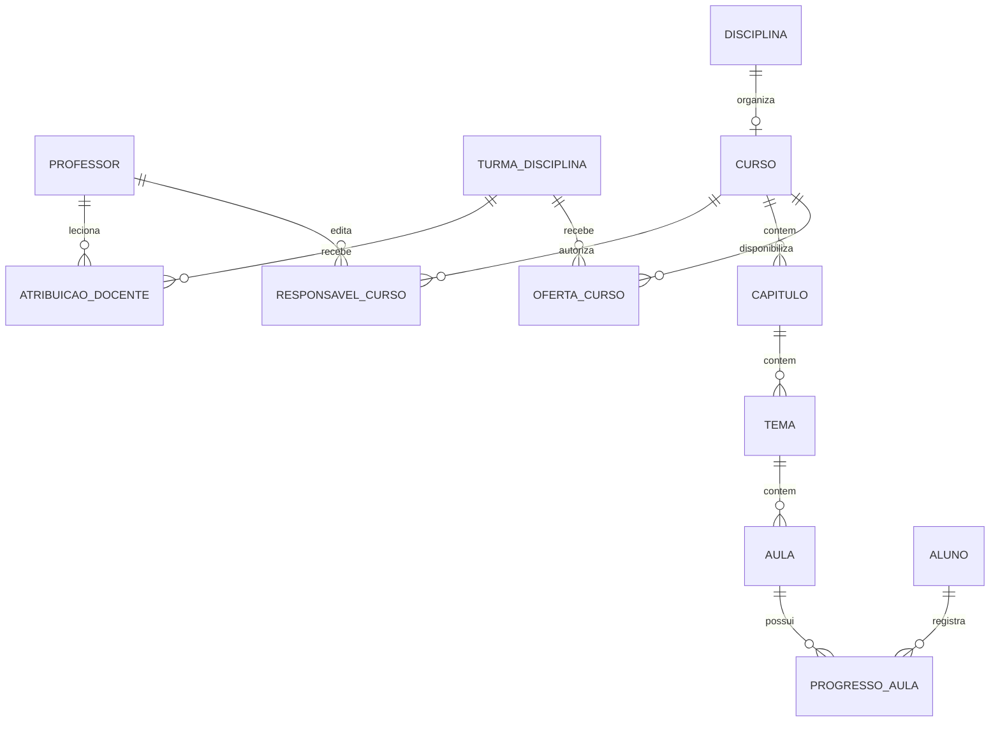

# EducaFast — evolução da gestão e dos cursos

Data: 23/10/2026. Situação: planejamento; funcionalidades e testes novos ainda não implementados.
Repositório de destino: https://github.com/Samucau1/Projeto-Educa-Fast
Código analisado: ../SamusChat/Projeto-Educa-Fast.

## Escopo e decisões

Sala significa turma virtual nesta proposta. Salas físicas, horários, videoconferência ao vivo, cobrança e certificados ficam para versões futuras.

1. Administradores criam, editam, organizam e arquivam turmas; matriculam alunos e atribuem professores e disciplinas.
2. Um professor pode atuar em várias turmas e disciplinas. Cada atribuição identifica a combinação exata professor + turma + disciplina.
3. Cada disciplina oferece conteúdo organizado em capítulos, temas e videoaulas, com navegação e progresso do aluno.
4. Preservar Flask, SQLAlchemy, MySQL, Jinja e a interface atual; introduzir serviços de aplicação para concentrar regras novas.

## Diagnóstico do código existente

O README e os modelos já descrevem criação administrativa de turmas e disciplinas. Existem professores_turmas, professores_disciplinas e turmas_disciplinas com unicidade dos pares. Esses três pares não representam de forma inequívoca a atribuição docente de uma disciplina em uma turma: não se deve autorizar a combinação pelo simples cruzamento dos pares.

Os guards administrativos aceitam admin e superadmin. A autorização das novas operações deverá combinar perfil ativo e vínculo com o recurso em cada requisição.

O relatório anterior registra 41 cenários de regressão MySQL, 8 unitários incluídos nesses 41 e 124 requisições Postman com 163 verificações. Esses resultados são históricos, não validação das novas funcionalidades.

## Permissões propostas

| Operação | Superadmin | Admin | Professor | Aluno |
| --- | --- | --- | --- | --- |
| Criar, editar e arquivar turma | Sim | Sim | Não | Não |
| Matricular e remover vínculo de aluno | Sim | Sim | Não | Não |
| Atribuir ou revogar atuação docente | Sim | Sim | Não | Não |
| Criar estrutura de curso | Sim | Sim | Somente disciplina sob sua responsabilidade | Não |
| Editar rascunho de aula | Sim | Sim | Somente conteúdo sob sua responsabilidade | Não |
| Publicar e arquivar conteúdo | Sim | Sim | Não na primeira versão | Não |
| Consultar conteúdo publicado | Sim | Sim | Conforme atribuição | Conforme matrícula ativa |
| Registrar progresso | Não em nome de outro | Não em nome de outro | Não em nome de outro | Somente o próprio |

Na primeira versão, todos os administradores podem gerir as turmas da instalação. Separação por escola/unidade requer entidade e escopo próprios antes de atender várias instituições. Professor responsável pelo curso é atribuído explicitamente pela administração; lecionar uma disciplina não concede automaticamente edição do curso compartilhado inteiro.

## Modelo de dados proposto

| Entidade | Campos e regras principais |
| --- | --- |
| Turma existente | Adicionar estado ativa/arquivada; arquivamento preserva histórico e impede novas alterações acadêmicas |
| AtribuicaoDocente | professor_id, turma_disciplina_id, ativo; unicidade do par professor/oferta; chaves estrangeiras obrigatórias |
| Curso | disciplina_id, título, descrição, estado rascunho/publicado/arquivado; um curso por disciplina inicialmente |
| ResponsavelCurso | curso_id, professor_id; atribuição administrativa explícita e única por par |
| Capitulo | curso_id, título, posição |
| Tema | capitulo_id, título, posição |
| Aula | tema_id, título, descrição, provedor_video, video_id, duração opcional, posição, estado, publicada_em |
| OfertaCurso | curso_id, turma_disciplina_id; liberação explícita para turma e disciplina compatível |
| ProgressoAula | aluno_id, aula_id, concluida_em; unicidade aluno/aula e gravação idempotente |
| EventoAuditoria | ator, ação, recurso, data e mudanças relevantes; sem tokens, senhas ou dados pessoais desnecessários |

Disciplina é o catálogo acadêmico; turma-disciplina é sua oferta para uma turma; curso é o material reutilizável. A primeira versão compartilha o mesmo conteúdo entre ofertas. Customizações por turma e versionamento pedagógico ficam para evolução posterior.

Posições devem ser únicas por pai e reordenadas em transação. Movimentar tema/aula entre cursos exige revalidar autorização e integridade. Não permitir apagar conteúdo referenciado pelo progresso; arquivar preserva os registros.

## Regras de acesso e conteúdo

- Acesso do aluno exige matrícula ativa na turma, disciplina compatível, oferta liberada, curso publicado e aula publicada. Revogar matrícula ou arquivar a turma revoga o acesso imediatamente, preservando o histórico.
- Todas as consultas, downloads, gravações e rotas de progresso aplicam as mesmas regras no servidor, inclusive por IDs recebidos diretamente.
- Professor só lança atividades e notas na combinação autorizada. A revogação de atribuição tem efeito na próxima requisição.
- Publicação exige título, hierarquia válida e vídeo válido; curso precisa ter ao menos uma aula publicável. Capítulos e temas vazios não aparecem ao aluno.
- Vídeos inicialmente incorporados por provedores explicitamente permitidos; armazenar identificador validado, nunca HTML de iframe informado pelo usuário. Não buscar URLs arbitrárias no backend. Vídeo externo não listado não oferece proteção contra compartilhamento do link.
- Conclusão é confirmação do aluno, sem alegar comprovação de tempo assistido. Progresso é aulas publicadas concluídas / aulas publicadas disponíveis; curso vazio mostra 0%. Aula arquivada sai do denominador, mantendo seu histórico.
- Manter CSRF, autenticação e escape de conteúdo; erros não devem revelar conteúdo de outras turmas. Padronizar erros JSON nas rotas novas e manter contratos das rotas antigas.

## Arquitetura e interface

Fluxo: rota/guard → serviço de autorização e aplicação → modelos/transação → template ou JSON. Criar serviços para atribuição docente, publicação e progresso, reutilizados por todas as entradas HTTP.

Administrador: lista de turmas com estado e filtros; detalhe com alunos, disciplinas, professores por disciplina e cursos liberados; editor de estrutura e revisão de publicação.

Professor: painel com várias turmas, filtro por disciplina e indicação de suas atribuições; editor de cursos sob sua responsabilidade, com prévia e envio à revisão administrativa.

Aluno: cartões das disciplinas, progresso e botão continuar; página do curso com capítulos expansíveis, temas e aulas; player com título, descrição, anterior/próxima e marcar conclusão. Incluir estados vazio, carregando, falha e acesso revogado, navegação por teclado e layout móvel.

Rotas propostas, a ajustar ao padrão existente: gestão em /admin/turmas e /admin/atribuicoes; autoria em /professor/cursos; revisão em /admin/cursos; consumo em /aluno/cursos/<id>; progresso em POST /aluno/aulas/<id>/conclusao. Rascunhos e prévias devem ter rotas protegidas próprias.

## Migração e compatibilidade

Introduzir migrações versionadas, por exemplo Alembic, antes de alterar o esquema persistente; create_all não substitui migração de banco existente. Backup e ensaio em cópia sintética antes de executar em ambiente real.

Criar tabelas e colunas de forma aditiva. Gerar relatório de candidatos a atribuição a partir dos pares existentes, mas exigir validação administrativa: não cruzar automaticamente todas as turmas e disciplinas de cada professor. Resolver vínculos ambíguos antes de ativar as regras novas. Preservar associações antigas durante a transição; definir uma fonte de verdade e impedir divergência entre gravações antigas e novas.

Notas hoje são únicas por aluno/disciplina. Não alterar silenciosamente esse contrato nesta entrega: manter notas atuais e documentar a limitação entre períodos/turmas. Evoluir notas por oferta/período em migração própria antes de permitir históricos que exijam essa distinção.

Rollback: desativar telas/rotas novas com configuração, manter dados adicionados e restaurar a versão anterior compatível. Não remover tabelas com progresso nem restaurar backup por cima de novas gravações sem procedimento de recuperação.

## Etapas de implementação e critérios de conclusão

| Etapa | Entrega | Critério para avançar |
| --- | --- | --- |
| 0 — Base | Inventariar alterações existentes, confirmar branch/remoto, executar testes atuais e registrar evidências | Falhas resolvidas ou impedimentos documentados; baseline identificada por commit |
| 1 — Dados | Migrações, atribuição docente e estados de turma | Migração de banco vazio e legado ensaiada em SQLite/MySQL; nenhuma atribuição ambígua concedida |
| 2 — Gestão | Permissões administrativas, gestão de turmas, vínculos por disciplina, auditoria | CRUD e revogação funcionam; professor/aluno não conseguem administrar |
| 3 — Curso | Capítulos, temas, aulas, responsáveis, ordenação e revisão/publicação | Rascunhos privados, ordenação íntegra e publicação validada |
| 4 — Aprendizagem | Oferta por turma, player, navegação, progresso e continuar | Isolamento entre turmas e progresso persistido e idempotente |
| 5 — Homologação | Atualizar suítes, coleção Postman e roteiro manual; executar regressão e carga | Novos cenários e regressão aprovados com evidências atuais |
| 6 — GitHub | Revisar diff, commits e publicar no origin confirmado | Push concluído e SHA/branch/URL informados |

## Plano de testes atualizado

| Grupo | Cenários obrigatórios e resultado esperado |
| --- | --- |
| Permissões | Admin/superadmin criam turma; professor/aluno/visitante são bloqueados; CSRF ausente bloqueia mutação |
| Vínculos | Professor em duas turmas e duas disciplinas; só combinações explicitamente atribuídas autorizam atividade/nota; duplicata não cria segundo vínculo |
| Revogação | Revogar professor ou matrícula invalida acesso na próxima requisição, inclusive com sessão/JWT anteriores |
| Cursos | CRUD da hierarquia; pai inexistente; validação de títulos; aula fora do curso; professor sem responsabilidade bloqueado |
| Publicação | Rascunho invisível por URL direta; publicação incompleta recusada; conteúdo publicado aparece só nas ofertas liberadas |
| Vídeo | Provedor/ID válido aceito; esquema javascript, HTML e host disfarçado recusados; nenhum fetch arbitrário |
| Progresso | Dois envios e envios concorrentes produzem um registro; aluno não grava para outro; denominador muda conforme aulas publicadas |
| Integridade | Reordenação concorrente não duplica posições; arquivamento preserva progresso; transação falha sem persistência parcial |
| Migração | Base vazia, base legada, dados ambíguos, reexecução controlada e rollback de aplicação |
| Interface | Fluxo admin → professor → aluno em navegador real; player, teclado, móvel, estados vazios e acesso revogado |
| Regressão | Login, LGPD, documentos, notas, atividades e demais cenários anteriores continuam aprovados |
| Carga | Leituras de curso e conclusões concorrentes em MySQL descartável, com checagem direta de integridade |

Adicionar cenários Python de autorização/serviços e integração, atualizar gerador e coleção Postman, estender fixtures com duas turmas, duas disciplinas, dois professores e alunos com vínculos diferentes. Usar somente dados sintéticos e ambientes descartáveis; executar suítes que recriam banco em sequência.

Critério de aceite: zero falhas inesperadas, zero HTTP 5xx nos fluxos exercitados, nenhum acesso cruzado, nenhuma duplicação por concorrência e evidências vinculadas ao commit testado. Definir volume e p95 de carga comparável ao baseline antes de executar; não inferir SLA de produção da carga local.

Atualizar Documentos/testes/README.md, TESTE_MANUAL.md e relatório de validação com resultados reais, duração, ambiente, comandos, falhas e limitações. Não incrementar contagens ou declarar aprovação antes da execução.

## Estratégia de commits e publicação

O origin local já aponta para Samucau1/Projeto-Educa-Fast; upstream aponta para outro repositório. Publicar exclusivamente no origin solicitado. Revisar primeiro as alterações já staged: elas incluem trabalho anterior de segurança/LGPD e testes e não devem ser misturadas automaticamente ao planejamento.

Sequência sugerida: baseline validada do trabalho anterior; documentação de arquitetura; migrações e vínculos; gestão/permissões; autoria/publicação; experiência do aluno/progresso; testes/evidências. Cada mudança funcional inclui seus testes.

Antes do push, conferir diff e staged, exclusão de .env, chaves, certificados, bancos, uploads reais e caches; confirmar branch de destino, sincronizar com origin sem sobrescrever trabalho remoto e resolver divergências. Executar verificações aplicáveis, criar commits descritivos e fazer push normal, sem force. Registrar os SHAs e o resultado real do envio.

Esta entrega documenta a arquitetura e as etapas. Não executa migrações, não implementa funcionalidades e não publica o conjunto anterior de alterações.
