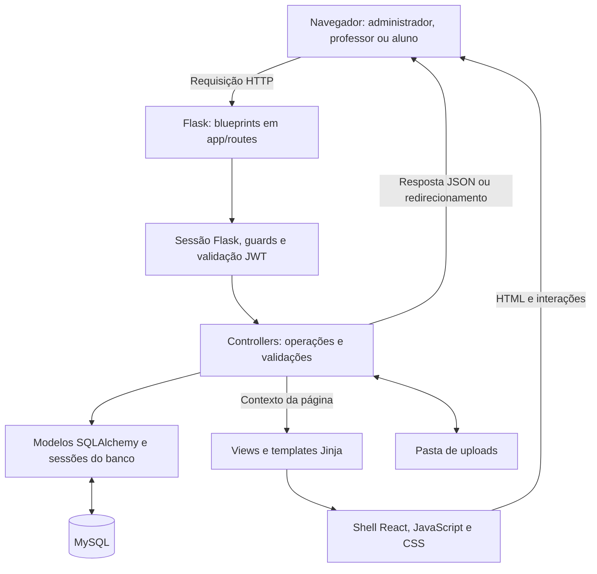
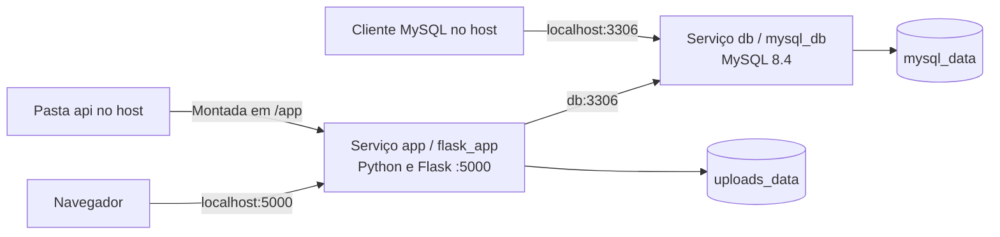
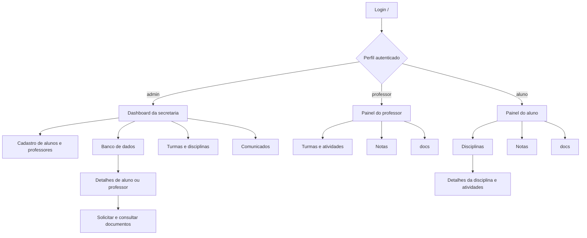

# Educa Fast — Secretaria Escolar DF

[](https://github.com/Samucau1/Projeto-Educa-Fast/actions/workflows/ci.yml)

Sistema web de gestão escolar que centraliza cadastros, turmas, disciplinas, comunicados, notas, atividades e documentos. A aplicação possui áreas para a secretaria (administrador), professores e alunos.

## Índice

- [Funcionalidades](#funcionalidades)
- [Tecnologias e arquitetura](#tecnologias-e-arquitetura)
- [Arquitetura em camadas](#arquitetura-em-camadas)
- [Telas do sistema](#telas-do-sistema)
- [Estrutura do repositório](#estrutura-do-repositório)
- [Como executar](#como-executar)
- [Validação e limites atuais](#validação-e-limites-atuais)
- [Documentação e licença](#documentação-e-licença)

## Configuração institucional

O superadmin configura a identidade da escola, o calendário, dias letivos, feriados/recessos/reposições e versões das regras de boletim. Semestres, trimestres, bimestres, pesos anuais e arredondamento são aplicados explicitamente por turma, preservando históricos. Consulte [o guia](docs/CONFIGURACAO_INSTITUCIONAL.md), [o protocolo obrigatório de design](docs/PROTOCOLO_DESIGN.md) e [a validação](docs/testes/RELATORIO_ESCOLA.md).

## Diário e boletim por período

O sistema inclui revisão explícita das atribuições antigas, avaliações com pesos e notas separadas por turma, ano e período. Professores lançam e publicam notas; a secretaria gerencia períodos e o vínculo das notas anteriores. Consulte [uso e arquitetura](docs/DIARIO_E_RECONCILIACAO.md) e [homologação](docs/testes/RELATORIO_ACADEMICO.md).

## Cursos reutilizáveis

Professores organizam cursos em capítulos, temas e videoaulas. A administração publica o conteúdo e libera o mesmo curso para várias turmas e anos, com progresso separado por oferta. Cursos publicados são preservados; novas edições podem ser duplicadas em rascunho. A tela **Gestão acadêmica** permite atribuir professor, turma e disciplina explicitamente.

Consulte [arquitetura e uso](docs/CURSOS_REUTILIZAVEIS.md) e [validação dos cursos](docs/testes/RELATORIO_CURSOS.md).

## Funcionalidades

| Perfil | Recursos implementados |
| --- | --- |
| Administrador | Consultar o painel da secretaria; cadastrar e editar alunos e professores; criar disciplinas e turmas; associar alunos e professores às turmas e professores às disciplinas; publicar comunicados; solicitar, enviar e consultar documentos. |
| Professor | Consultar turmas e alunos vinculados; lançar atividades com anexos; registrar ou atualizar notas; consultar comunicados; enviar documentos solicitados pela secretaria. |
| Aluno | Consultar disciplinas, notas, atividades e comunicados; baixar arquivos disponíveis; enviar documentos solicitados pela secretaria. |

Os cadastros incluem dados específicos de cada perfil e foto opcional em JPG ou PNG de até 2 MB. As notas devem estar entre 0 e 10, com validação dos vínculos entre professor, aluno, turma e disciplina. Existe uma nota por aluno e disciplina; um novo lançamento atualiza esse registro.

## Tecnologias e arquitetura

- **Backend:** Python 3.12, Flask 3.1 e templates Jinja.
- **Banco:** SQLAlchemy 2.0, PyMySQL e MySQL 8.4.
- **Interface:** HTML5, CSS, JavaScript, Tailwind CSS e React 18 via CDN.
- **Ambiente:** Docker, Docker Compose e python-dotenv.
- **Dependência de criptografia:** cryptography, incluída nos requisitos Python.

O ponto de entrada `api/app.py` chama `create_app()`, carrega a configuração, inicializa o banco e registra os blueprints. As rotas encaminham as operações aos controllers, que consultam os modelos SQLAlchemy e retornam páginas ou respostas JSON.

O HTML é renderizado no servidor com Jinja. Um shell React monta esse conteúdo no navegador, e scripts compartilhados e por página controlam abas, formulários e interações. Não há etapa de build com Node.js. O navegador precisa de internet para carregar as dependências externas da interface.

O login verifica senhas armazenadas como hash pelo Werkzeug, estabelece uma sessão Flask e retorna um JWT HS256. As páginas verificam o perfil pela sessão; algumas rotas JSON exigem o cabeçalho `Authorization: Bearer <token>`.

## Arquitetura em camadas

A organização segue uma separação de responsabilidades semelhante ao MVC, com blueprints para as rotas. As views de `app/views/` atendem à página inicial e ao dashboard administrativo; outras rotas renderizam os templates diretamente.



| Camada | Arquivos/pastas | Responsabilidade |
| --- | --- | --- |
| Inicialização | `app.py`, `app/__init__.py`, `config.py` | Criar a aplicação, carregar configurações e registrar rotas. |
| Entrada HTTP | `app/routes/` | Receber formulários, JSON e arquivos; selecionar a operação e montar a resposta. |
| Autenticação e acesso | `app/auth.py`, `app/routes/guards.py` | Assinar/validar JWTs e verificar o perfil nas rotas protegidas. |
| Aplicação | `app/controllers/` | Executar cadastros, associações, consultas dos painéis, notas, atividades e documentos. |
| Persistência | `app/models/`, `app/database.py` | Mapear entidades e vínculos, abrir sessões e inicializar o esquema. |
| Apresentação | `app/views/`, `app/templates/` | Renderizar páginas com os dados preparados pelo backend. |
| Interação no navegador | `app/static/js/compartilhado/`, `app/static/js/paginas/` | Montar o shell React, alternar abas e processar interações específicas. |
| Estilos e recursos comuns | `app/static/css/`, `app/templates/partials/` | Definir estilos por tela e carregar o runtime compartilhado do React. |

### Implantação com containers



O serviço `app` usa o Dockerfile Python e depende do estado saudável de `db`. O serviço `db` usa a imagem `mysql:8.4`. A aplicação acessa o banco pelo nome do serviço na rede interna do Compose; os volumes mantêm os dados e os anexos entre reinicializações.

### Organização dos dados

| Grupo | Modelos e vínculos |
| --- | --- |
| Identidade | `UsuarioModel` armazena e-mail, hash de senha e perfil. `AlunoModel` e `ProfessorModel` armazenam os dados específicos e referenciam o usuário. |
| Organização acadêmica | `TurmaModel` e `DisciplinaModel`, ligados por `TurmaDisciplinaModel`. Os vínculos de participação ficam em `AlunoTurmaModel`, `ProfessorTurmaModel` e `ProfessorDisciplinaModel`; também existe `AlunoDisciplinaModel`. |
| Ensino | `AtividadeModel` relaciona professor, turma e disciplina. `NotaModel` relaciona aluno, professor e disciplina, com unicidade por aluno/disciplina. |
| Comunicação | `ComunicadoModel` armazena os recados publicados pela secretaria. |
| Documentação | `DocumentoModel` registra os metadados dos arquivos. `SolicitacaoDocumentoModel` registra destinatário, status e eventual documento enviado. Os arquivos ficam na pasta de uploads. |

## Telas do sistema

O catálogo abaixo descreve as telas implementadas e aponta para seus templates. Para visualizá-las em funcionamento, execute a aplicação e entre com o perfil correspondente. As abas dos painéis de professor e aluno são seções da mesma página.

### Login

| Tela e template | Rota | Conteúdo e ações |
| --- | --- | --- |
| [Login](api/app/templates/login.html) | `/` | Campos de e-mail institucional e senha. Após autenticar, o usuário é direcionado ao painel de seu perfil. |

### Secretaria / administrador

| Tela e template | Rota principal | Conteúdo e ações |
| --- | --- | --- |
| [Dashboard da secretaria](api/app/templates/admin_painel.html) | `/admin/dashboard` | Saudação, totais de alunos e professores, matrículas pendentes e últimos registros. Menu lateral para as áreas administrativas. |
| [Cadastro de alunos](api/app/templates/admin_cadastro_aluno.html) | `/admin/cadastro-alunos` | Dados pessoais e acadêmicos, matrícula, credenciais de acesso e foto de perfil. |
| [Cadastro de professores](api/app/templates/admin_cadastro_professores.html) | `/admin/cadastro-professores` | Nome, CPF, contato, disciplina principal, formação, regime de trabalho, admissão, credenciais e foto. |
| [Banco de dados](api/app/templates/admin_banco_dados.html) | `/admin/banco-de-dados` | Indicadores, listagem de registros acadêmicos e busca por nome ou ID, com acesso aos detalhes dos cadastros. É uma tela de consulta de pessoas, sem editor SQL. |
| [Detalhes do aluno](api/app/templates/admin_detalhes_aluno.html) | `/admin/alunos/<aluno_id>` | Perfil, edição cadastral, solicitações de documentos e arquivos enviados. |
| [Detalhes do professor](api/app/templates/admin_detalhes_professor.html) | `/admin/professores/<professor_id>` | Perfil e edição cadastral, aba de atuação e aba de documentos com solicitações e arquivos enviados. |
| [Disciplinas](api/app/templates/admin_disciplinas.html) | `/admin/disciplinas` | Criação com nome, código e carga horária; listagem e associação de professores. |
| [Turmas](api/app/templates/admin_turmas.html) | `/admin/turmas` | Cadastro e listagem de turmas, associação de alunos e professores e consulta das disciplinas vinculadas. |
| [Comunicados](api/app/templates/admin_comunicados.html) | `/admin/comunicados` | Formulário com título e mensagem e consulta dos recados publicados. |

### Professor

O [painel do professor](api/app/templates/professor_painel.html), em `/professor/dashboard` (também `/professor`), reúne:

| Aba | Conteúdo e ações |
| --- | --- |
| Turmas | Turmas vinculadas, alunos, disciplinas e lançamento de atividades, com possibilidade de anexar arquivo. |
| Notas | Formulários de lançamento por aluno e disciplina, nota de 0 a 10, observação e consulta das notas lançadas. |
| Documentos | Solicitações da secretaria, envio do arquivo de resposta e consulta dos documentos enviados. |

### Aluno

| Tela e template | Rota principal | Conteúdo e ações |
| --- | --- | --- |
| [Painel do aluno](api/app/templates/aluno_painel.html) | `/aluno/dashboard` (também `/aluno`) | Abas de disciplinas, notas e documentos. Exibe as disciplinas associadas, as notas e observações e as solicitações de documentos, com upload de resposta e arquivos enviados. |
| [Detalhes da disciplina](api/app/templates/aluno_disciplina.html) | `/aluno/disciplinas/<disciplina_id>` | Informações da disciplina, professores e atividades com arquivos disponíveis para download. |

### Navegação entre as telas



Para percorrer as telas com conteúdo, cadastre os usuários, configure as associações acadêmicas e lance dados conforme o [fluxo inicial](#5-preparar-o-fluxo-escolar). Listagens sem registros apresentam estados vazios; os dados exibidos dependem do perfil e dos vínculos cadastrados.

## Estrutura do repositório

```text
Projeto-Educa-Fast/
├── docs/       # Documentação: integrantes, BMC, modelo de dados, casos de uso, testes e protótipo
├── api/        # Backend Flask (API e, nesta versão, as telas Jinja)
├── web/        # Aplicação web React/Vite (migração em andamento)
├── .github/    # CI (GitHub Actions)
├── iniciar-educafast.ps1 / .cmd      # Atalhos para o ambiente de teste manual (Windows)
├── LICENSE
└── README.md
```

Cada aplicação tem seu próprio `README.md`, com instalação, configuração e execução logo no início.

## Como executar

O sistema completo roda a partir da pasta `api/`. Siga o passo a passo de [`api/README.md`](api/README.md). Resumo com Docker:

```bash
cd api
cp .env.example .env   # preencha SECRET_KEY, DATA_ENCRYPTION_KEY, DB_PASSWORD e MYSQL_ROOT_PASSWORD
docker compose up -d --build
docker compose exec app python -m app.seed
```

Depois acesse [http://localhost:5000](http://localhost:5000).

A pasta [`web/`](web/README.md) guarda a nova interface React, que ainda está em migração. Por enquanto as telas em uso são servidas pela própria API.

## Validação e limites atuais

O repositório inclui regressão automatizada, cenários de segurança/LGPD e coleção Postman. Consulte [Testes](docs/testes/README.md). Para o fluxo manual, entre com cada perfil, configure os vínculos de turma/disciplina e confira os controles de acesso e privacidade em banco descartável.

O Compose local usa Gunicorn, sem depuração, e publica a aplicação somente em loopback. Para produção com HTTPS e TLS verificado no MySQL, use o arquivo independente `api/docker-compose.production.yml`, após preparar chaves e certificados conforme [Segurança e LGPD](docs/SEGURANCA_E_LGPD.md). Não publique o servidor de desenvolvimento.

## Documentação e licença

- [Documentação completa do sistema](docs/DOCUMENTACAO_DO_SISTEMA.md)
- [Segurança, criptografia e LGPD — configuração e responsabilidades](docs/SEGURANCA_E_LGPD.md)
- [Testes de API/Postman e regressão](docs/testes/README.md)
- [Iniciar o ambiente manual](docs/testes/TESTE_MANUAL.md#iniciar-o-ambiente-em-segundo-plano): execute `.\iniciar-educafast.ps1` no PowerShell ou `.\iniciar-educafast.cmd` no CMD, na raiz do projeto.
- [Especificação de casos de uso](docs/Especificação%20de%20Casos%20de%20Uso.md)
- [Documentos do projeto](docs/) — integrantes e vídeo em [docs/README.md](docs/README.md)
- [Business Model Canvas](docs/BMC.md) e [modelo de dados](docs/DADOS.md) ([PDF](docs/DADOS.pdf))
- [Referência do protótipo](docs/prototipo/)
- [Licença MIT](LICENSE)
