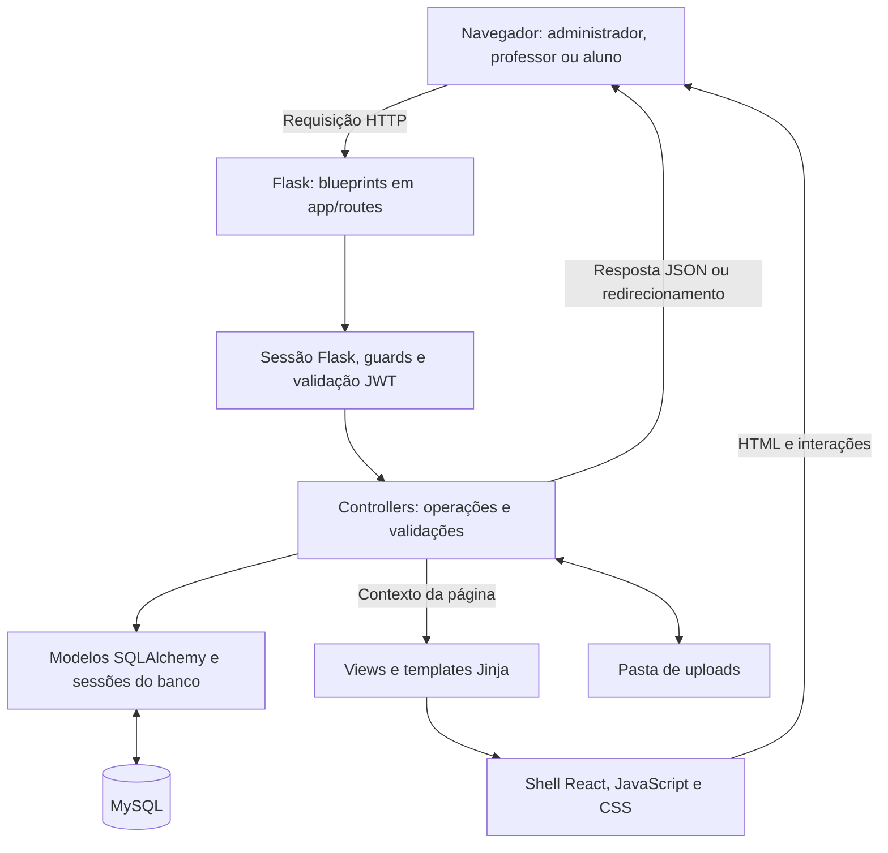
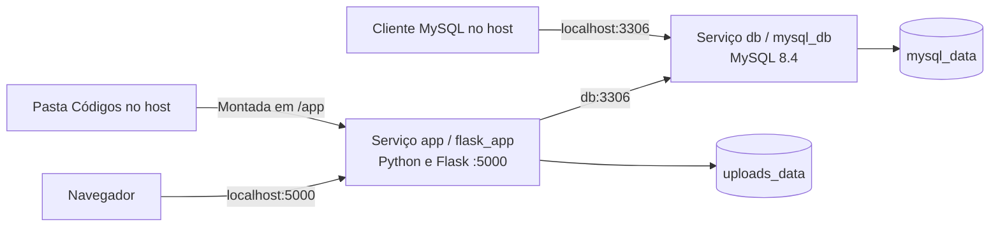
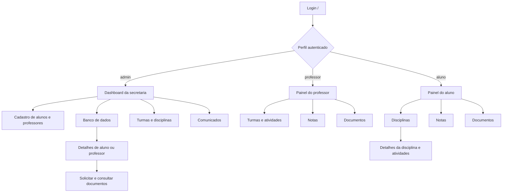

# Educa Fast — Secretaria Escolar DF

Sistema web de gestão escolar que centraliza cadastros, turmas, disciplinas, comunicados, notas, atividades e documentos. A aplicação possui áreas para a secretaria (administrador), professores e alunos.

## Índice

- [Funcionalidades](#funcionalidades)
- [Tecnologias e arquitetura](#tecnologias-e-arquitetura)
- [Arquitetura em camadas](#arquitetura-em-camadas)
- [Telas do sistema](#telas-do-sistema)
- [Estrutura](#estrutura)
- [Executar com Docker Compose](#executar-com-docker-compose)
- [Executar localmente sem Docker](#executar-localmente-sem-docker)
- [Configuração](#configuração)
- [Persistência](#persistência)
- [Principais rotas](#principais-rotas)
- [Comandos úteis](#comandos-úteis)
- [Validação e limites atuais](#validação-e-limites-atuais)
- [Documentação e licença](#documentação-e-licença)

## Diário e boletim por período

O sistema inclui revisão explícita das atribuições antigas, avaliações com pesos e notas separadas por turma, ano e período. Professores lançam e publicam notas; a secretaria gerencia períodos e o vínculo das notas anteriores. Consulte [uso e arquitetura](Documentos/DIARIO_E_RECONCILIACAO.md) e [homologação](Documentos/testes/RELATORIO_ACADEMICO.md).

## Cursos reutilizáveis

Professores organizam cursos em capítulos, temas e videoaulas. A administração publica o conteúdo e libera o mesmo curso para várias turmas e anos, com progresso separado por oferta. Cursos publicados são preservados; novas edições podem ser duplicadas em rascunho. A tela **Gestão acadêmica** permite atribuir professor, turma e disciplina explicitamente.

Consulte [arquitetura e uso](Documentos/CURSOS_REUTILIZAVEIS.md) e [validação dos cursos](Documentos/testes/RELATORIO_CURSOS.md).

## Funcionalidades

| Perfil | Recursos implementados |
| --- | --- |
| Administrador | Consultar o painel da secretaria; cadastrar e editar alunos e professores; criar disciplinas e turmas; associar alunos e professores às turmas e professores às disciplinas; publicar comunicados; solicitar, enviar e consultar documentos. |
| Professor | Consultar turmas e alunos vinculados; lançar atividades com anexos; registrar ou atualizar notas; consultar comunicados; enviar documentos solicitados pela secretaria. |
| Aluno | Consultar disciplinas, notas, atividades e comunicados; baixar arquivos disponíveis; enviar documentos solicitados pela secretaria. |

Os cadastros incluem dados específicos de cada perfil e foto opcional em JPG ou PNG de até 2 MB. As notas devem estar entre 0 e 10, com validação dos vínculos entre professor, aluno, turma e disciplina. Existe uma nota por aluno e disciplina; um novo lançamento atualiza esse registro.

## Tecnologias e arquitetura

- **Backend:** Python 3.12, Flask 3.1 e templates Jinja.
- **Banco:** SQLAlchemy 2.0, PyMySQL e MySQL 8.4.
- **Interface:** HTML5, CSS, JavaScript, Tailwind CSS e React 18 via CDN.
- **Ambiente:** Docker, Docker Compose e python-dotenv.
- **Dependência de criptografia:** cryptography, incluída nos requisitos Python.

O ponto de entrada `Códigos/app.py` chama `create_app()`, carrega a configuração, inicializa o banco e registra os blueprints. As rotas encaminham as operações aos controllers, que consultam os modelos SQLAlchemy e retornam páginas ou respostas JSON.

O HTML é renderizado no servidor com Jinja. Um shell React monta esse conteúdo no navegador, e scripts compartilhados e por página controlam abas, formulários e interações. Não há etapa de build com Node.js. O navegador precisa de internet para carregar as dependências externas da interface.

O login verifica senhas armazenadas como hash pelo Werkzeug, estabelece uma sessão Flask e retorna um JWT HS256. As páginas verificam o perfil pela sessão; algumas rotas JSON exigem o cabeçalho `Authorization: Bearer <token>`.

## Arquitetura em camadas

A organização segue uma separação de responsabilidades semelhante ao MVC, com blueprints para as rotas. As views de `app/views/` atendem à página inicial e ao dashboard administrativo; outras rotas renderizam os templates diretamente.



| Camada | Arquivos/pastas | Responsabilidade |
| --- | --- | --- |
| Inicialização | `app.py`, `app/__init__.py`, `config.py` | Criar a aplicação, carregar configurações e registrar rotas. |
| Entrada HTTP | `app/routes/` | Receber formulários, JSON e arquivos; selecionar a operação e montar a resposta. |
| Autenticação e acesso | `app/auth.py`, `app/routes/guards.py` | Assinar/validar JWTs e verificar o perfil nas rotas protegidas. |
| Aplicação | `app/controllers/` | Executar cadastros, associações, consultas dos painéis, notas, atividades e documentos. |
| Persistência | `app/models/`, `app/database.py` | Mapear entidades e vínculos, abrir sessões e inicializar o esquema. |
| Apresentação | `app/views/`, `app/templates/` | Renderizar páginas com os dados preparados pelo backend. |
| Interação no navegador | `app/static/js/compartilhado/`, `app/static/js/paginas/` | Montar o shell React, alternar abas e processar interações específicas. |
| Estilos e recursos comuns | `app/static/css/`, `app/templates/partials/` | Definir estilos por tela e carregar o runtime compartilhado do React. |

### Implantação com containers



O serviço `app` usa o Dockerfile Python e depende do estado saudável de `db`. O serviço `db` usa a imagem `mysql:8.4`. A aplicação acessa o banco pelo nome do serviço na rede interna do Compose; os volumes mantêm os dados e os anexos entre reinicializações.

### Organização dos dados

| Grupo | Modelos e vínculos |
| --- | --- |
| Identidade | `UsuarioModel` armazena e-mail, hash de senha e perfil. `AlunoModel` e `ProfessorModel` armazenam os dados específicos e referenciam o usuário. |
| Organização acadêmica | `TurmaModel` e `DisciplinaModel`, ligados por `TurmaDisciplinaModel`. Os vínculos de participação ficam em `AlunoTurmaModel`, `ProfessorTurmaModel` e `ProfessorDisciplinaModel`; também existe `AlunoDisciplinaModel`. |
| Ensino | `AtividadeModel` relaciona professor, turma e disciplina. `NotaModel` relaciona aluno, professor e disciplina, com unicidade por aluno/disciplina. |
| Comunicação | `ComunicadoModel` armazena os recados publicados pela secretaria. |
| Documentação | `DocumentoModel` registra os metadados dos arquivos. `SolicitacaoDocumentoModel` registra destinatário, status e eventual documento enviado. Os arquivos ficam na pasta de uploads. |

## Telas do sistema

O catálogo abaixo descreve as telas implementadas e aponta para seus templates. Para visualizá-las em funcionamento, execute a aplicação e entre com o perfil correspondente. As abas dos painéis de professor e aluno são seções da mesma página.

### Login

| Tela e template | Rota | Conteúdo e ações |
| --- | --- | --- |
| [Login](Códigos/app/templates/login.html) | `/` | Campos de e-mail institucional e senha. Após autenticar, o usuário é direcionado ao painel de seu perfil. |

### Secretaria / administrador

| Tela e template | Rota principal | Conteúdo e ações |
| --- | --- | --- |
| [Dashboard da secretaria](Códigos/app/templates/admin_painel.html) | `/admin/dashboard` | Saudação, totais de alunos e professores, matrículas pendentes e últimos registros. Menu lateral para as áreas administrativas. |
| [Cadastro de alunos](Códigos/app/templates/admin_cadastro_aluno.html) | `/admin/cadastro-alunos` | Dados pessoais e acadêmicos, matrícula, credenciais de acesso e foto de perfil. |
| [Cadastro de professores](Códigos/app/templates/admin_cadastro_professores.html) | `/admin/cadastro-professores` | Nome, CPF, contato, disciplina principal, formação, regime de trabalho, admissão, credenciais e foto. |
| [Banco de dados](Códigos/app/templates/admin_banco_dados.html) | `/admin/banco-de-dados` | Indicadores, listagem de registros acadêmicos e busca por nome ou ID, com acesso aos detalhes dos cadastros. É uma tela de consulta de pessoas, sem editor SQL. |
| [Detalhes do aluno](Códigos/app/templates/admin_detalhes_aluno.html) | `/admin/alunos/<aluno_id>` | Perfil, edição cadastral, solicitações de documentos e arquivos enviados. |
| [Detalhes do professor](Códigos/app/templates/admin_detalhes_professor.html) | `/admin/professores/<professor_id>` | Perfil e edição cadastral, aba de atuação e aba de documentos com solicitações e arquivos enviados. |
| [Disciplinas](Códigos/app/templates/admin_disciplinas.html) | `/admin/disciplinas` | Criação com nome, código e carga horária; listagem e associação de professores. |
| [Turmas](Códigos/app/templates/admin_turmas.html) | `/admin/turmas` | Cadastro e listagem de turmas, associação de alunos e professores e consulta das disciplinas vinculadas. |
| [Comunicados](Códigos/app/templates/admin_comunicados.html) | `/admin/comunicados` | Formulário com título e mensagem e consulta dos recados publicados. |

### Professor

O [painel do professor](Códigos/app/templates/professor_painel.html), em `/professor/dashboard` (também `/professor`), reúne:

| Aba | Conteúdo e ações |
| --- | --- |
| Turmas | Turmas vinculadas, alunos, disciplinas e lançamento de atividades, com possibilidade de anexar arquivo. |
| Notas | Formulários de lançamento por aluno e disciplina, nota de 0 a 10, observação e consulta das notas lançadas. |
| Documentos | Solicitações da secretaria, envio do arquivo de resposta e consulta dos documentos enviados. |

### Aluno

| Tela e template | Rota principal | Conteúdo e ações |
| --- | --- | --- |
| [Painel do aluno](Códigos/app/templates/aluno_painel.html) | `/aluno/dashboard` (também `/aluno`) | Abas de disciplinas, notas e documentos. Exibe as disciplinas associadas, as notas e observações e as solicitações de documentos, com upload de resposta e arquivos enviados. |
| [Detalhes da disciplina](Códigos/app/templates/aluno_disciplina.html) | `/aluno/disciplinas/<disciplina_id>` | Informações da disciplina, professores e atividades com arquivos disponíveis para download. |

### Navegação entre as telas



Para percorrer as telas com conteúdo, cadastre os usuários, configure as associações acadêmicas e lance dados conforme o [fluxo inicial](#5-preparar-o-fluxo-escolar). Listagens sem registros apresentam estados vazios; os dados exibidos dependem do perfil e dos vínculos cadastrados.

## Estrutura

```text
Projeto-Educa-Fast/
├── Códigos/
│   ├── app/
│   │   ├── controllers/    # Operações de cadastro, gestão e painéis
│   │   ├── models/         # Entidades e relacionamentos SQLAlchemy
│   │   ├── routes/         # Blueprints e verificações de acesso
│   │   ├── static/         # CSS e JavaScript compartilhado/por página
│   │   ├── templates/      # Páginas Jinja e runtime React
│   │   ├── views/          # Funções de renderização
│   │   ├── auth.py         # Geração e validação de JWT
│   │   ├── database.py     # Engine, sessões e inicialização do esquema
│   │   └── seed.py         # Administrador de demonstração
│   ├── app.py
│   ├── config.py
│   ├── .env.example
│   ├── Dockerfile
│   ├── docker-compose.yml
│   └── requirements.txt
├── Documentos/             # Casos de uso e plano de negócios
├── Protótipo/              # Referência do protótipo no Figma
├── dashboard.html          # HTML avulso; não inicia a aplicação
├── LICENSE
└── README.md
```

## Executar com Docker Compose

Requisitos: Git, Docker e Docker Compose (comando `docker compose`). A porta local `5000` precisa estar disponível; o MySQL permanece na rede interna, sem porta publicada.

### 1. Obter o projeto

```bash
git clone https://github.com/Samucau1/Projeto-Educa-Fast.git
cd Projeto-Educa-Fast
cd "Códigos"
```

### 2. Configurar o ambiente

Copie o exemplo para `.env`. No PowerShell:

```powershell
Copy-Item .env.example .env
```

No Linux/macOS:

```bash
cp .env.example .env
```

Edite `.env` e configure `SECRET_KEY`, `DATA_ENCRYPTION_KEY`, `DB_PASSWORD` e `MYSQL_ROOT_PASSWORD` com valores próprios. A chave Fernet deve ser gerada e guardada conforme [Segurança e LGPD](Documentos/SEGURANCA_E_LGPD.md). Não publique credenciais reais.

### 3. Iniciar os serviços

Execute dentro de `Códigos/`:

```bash
docker compose up -d --build
docker compose ps
docker compose logs -f app
```

O serviço `app` aguarda o healthcheck do MySQL antes de iniciar. Na inicialização, a aplicação cria as tabelas e aplica os ajustes de esquema previstos em `app/database.py`.

### 4. Criar o administrador em um banco novo

> **Atenção:** o seed executa a exclusão de todos os registros de usuários antes de inserir o administrador. Use apenas na preparação de um banco novo de desenvolvimento. Reexecutá-lo em uma base com dados pode apagar acessos ou falhar por vínculos de chave estrangeira. O script não cria alunos, professores, disciplinas nem turmas.

Após a aplicação inicializar as tabelas:

```bash
docker compose exec app python -m app.seed
```

Acesse [http://localhost:5000](http://localhost:5000) com as credenciais de demonstração:

| Campo | Valor |
| --- | --- |
| E-mail | `admin@admin.com` |
| Senha | `123` |

Esses valores estão fixos em `app/seed.py`. Antes de utilizar o seed em outro ambiente, substitua as credenciais no script.

### 5. Preparar o fluxo escolar

1. Entre como administrador e cadastre alunos e professores, definindo seus acessos.
2. Crie disciplinas e vincule os professores responsáveis.
3. Crie turmas com suas disciplinas e associe alunos e professores.
4. Entre como professor para lançar atividades e notas nas turmas vinculadas.
5. Entre como aluno para consultar as informações acadêmicas.
6. Pela secretaria, solicite documentos; o destinatário poderá enviá-los em seu painel.

## Executar localmente sem Docker

Use Python 3.12 e uma instância MySQL com banco e usuário previamente criados. Dentro de `Códigos/`, copie `.env.example` para `.env` e configure `DB_HOST=localhost` e as credenciais dessa instância.

No PowerShell:

```powershell
python -m venv .venv
.\.venv\Scripts\Activate.ps1
python -m pip install -r requirements.txt
python app.py
```

No Linux/macOS, ative o ambiente com `source .venv/bin/activate`. Depois que a aplicação criar as tabelas, execute `python -m app.seed` em outro terminal, dentro de `Códigos/` e com o ambiente virtual ativo, respeitando o aviso de exclusão de usuários acima. A aplicação fica em `http://localhost:5000`.

## Configuração

| Variável | Uso e comportamento |
| --- | --- |
| `SECRET_KEY` | Assina sessões e JWTs; obrigatória em todas as inicializações, com pelo menos 32 caracteres aleatórios. |
| `DATA_ENCRYPTION_KEY` | Chave Fernet independente, obrigatória para campos pessoais e arquivos. Preserve-a separadamente dos dados. |
| `LGPD_CONTROLADOR` / `LGPD_CONTATO` | Controlador (EducaFast) e contato de privacidade; contato obrigatório em produção. |
| `DB_HOST` | Host MySQL; padrão local `localhost`. O Compose define `db`. |
| `DB_PORT` | Porta de conexão ao MySQL; padrão `3306`. O Compose não publica o banco no host. |
| `DB_USER` | Usuário do banco; padrão local `root`, padrão do Compose `app_user`. |
| `DB_PASSWORD` | Senha do usuário do banco; obrigatória no Compose. |
| `DB_NAME` | Nome do banco; padrão `app_web`. |
| `MYSQL_ROOT_PASSWORD` | Senha administrativa na inicialização do container MySQL; obrigatória no Compose. |
| `JWT_EXPIRATION_HOURS` | Validade do JWT em horas; padrão `8`. |
| `UPLOAD_FOLDER` | Pasta dos arquivos enviados; padrão `uploads`. |
| `DB_URL` | URL SQLAlchemy opcional; substitui a conexão montada com as variáveis `DB_*`. |

Localmente, `config.py` lê o `.env` com `load_dotenv()`. No Docker, o Compose injeta as variáveis declaradas no serviço. `JWT_EXPIRATION_HOURS` e `DB_URL` não são repassadas explicitamente pelo bloco `environment`, mas podem ser lidas do `.env` montado em `/app`.

## Persistência

Os modelos representam usuários, alunos, professores, turmas, disciplinas, seus vínculos, notas, atividades, comunicados, documentos e solicitações de documentos. A inicialização cria o esquema e aplica alterações pontuais; não há ferramenta de migrações versionadas configurada.

No Compose, `mysql_data` persiste o banco e `uploads_data` persiste os arquivos em `/app/uploads`. Mantenha `UPLOAD_FOLDER=uploads` para usar esse volume como configurado. O código local é montado em `/app`.

As variáveis de criação de banco e credenciais do container MySQL são aplicadas na primeira inicialização de um volume vazio. Alterar somente o `.env` não atualiza as senhas de um banco existente; ajuste também os usuários no MySQL. Faça backup do banco e dos arquivos antes de alterações no ambiente.

`docker compose down` preserva os volumes. **Adicionar `-v` remove os volumes declarados, incluindo o banco e os uploads**; não use essa opção se precisar manter os dados.

## Principais rotas

| Método | Caminho | Finalidade |
| --- | --- | --- |
| GET | `/` | Login ou redirecionamento ao painel do perfil autenticado. |
| POST | `/login` | Recebe JSON com `email` e `senha`; retorna JWT e cria sessão. |
| GET / POST | `/logout` | GET confirma; POST com CSRF encerra a sessão Flask. |
| GET | `/admin/dashboard` | Painel da secretaria. |
| GET/POST | `/admin/turmas` | Cadastro de turmas e associações. |
| GET/POST | `/admin/disciplinas` | Disciplinas e vínculo com professores. |
| GET/POST | `/admin/comunicados` | Consulta e publicação de comunicados. |
| GET | `/professor/dashboard` | Painel do professor. |
| POST | `/professor/notas/salvar` | Registro ou atualização de nota. |
| POST | `/professor/atividades/lancar` | Criação de atividade, com anexo opcional. |
| GET | `/aluno/dashboard` | Painel do aluno. |
| GET | `/aluno/disciplinas/<disciplina_id>` | Detalhes de uma disciplina do aluno. |
| GET | `/alunos/busca` | Busca de alunos; exige JWT de professor. |
| POST | `/arquivos/upload` | Upload pela secretaria ou professor autenticado com JWT. |
| GET | `/arquivos/download/<filename>` | Download com verificação de autenticação/acesso. |

Consulte `Códigos/app/routes/` para os demais endpoints e aliases de compatibilidade.

## Comandos úteis

Dentro de `Códigos/`:

```bash
# Estado dos serviços
docker compose ps

# Logs da aplicação e do banco
docker compose logs -f app db

# Reconstruir após alterações nas dependências ou imagem
docker compose up -d --build

# Parar e remover containers, preservando volumes
docker compose down
```

Se a aplicação não iniciar, confira os logs, as credenciais e o estado de `db`. Conflitos nas portas `5000` ou `3306` exigem liberar a porta ou ajustar o mapeamento no Compose.

## Validação e limites atuais

O repositório inclui regressão automatizada, cenários de segurança/LGPD e coleção Postman. Consulte [Testes](Documentos/testes/README.md). Para o fluxo manual, entre com cada perfil, configure os vínculos de turma/disciplina e confira os controles de acesso e privacidade em banco descartável.

O Compose local usa Gunicorn, sem depuração, e publica a aplicação somente em loopback. Para produção com HTTPS e TLS verificado no MySQL, use o arquivo independente `Códigos/docker-compose.production.yml`, após preparar chaves e certificados conforme [Segurança e LGPD](Documentos/SEGURANCA_E_LGPD.md). Não publique o servidor de desenvolvimento.

## Documentação e licença

- [Documentação completa do sistema](Documentos/DOCUMENTACAO_DO_SISTEMA.md)
- [Segurança, criptografia e LGPD — configuração e responsabilidades](Documentos/SEGURANCA_E_LGPD.md)
- [Testes de API/Postman e regressão](Documentos/testes/README.md)
- [Iniciar o ambiente manual](Documentos/testes/TESTE_MANUAL.md#iniciar-o-ambiente-em-segundo-plano): execute `.\iniciar-educafast.ps1` no PowerShell ou `.\iniciar-educafast.cmd` no CMD, na raiz do projeto.
- [Especificação de casos de uso](Documentos/Especificação%20de%20Casos%20de%20Uso.md)
- [Documentos do projeto](Documentos/)
- [Referência do protótipo](Protótipo/)
- [Licença MIT](LICENSE)
