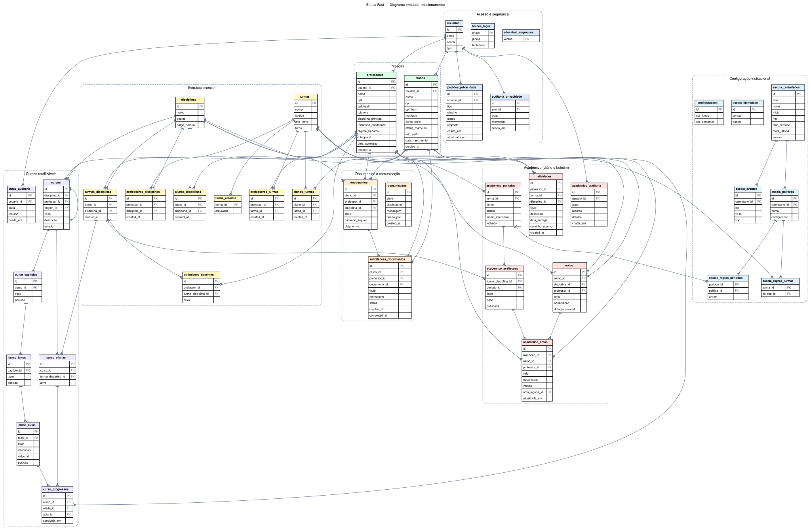

# Modelo de dados — Educa Fast

Documento gerado a partir dos modelos SQLAlchemy em `api/app/models/`. Banco: MySQL 8 (SQLite nos testes).
O esquema tem **39 tabelas**, agrupadas por domínio abaixo. O diagrama completo está em [`modelo-dados/DER.svg`](modelo-dados/DER.svg) (fonte editável: [`modelo-dados/DER.dot`](modelo-dados/DER.dot)).

Convenções: **PK** chave primária, **FK** chave estrangeira, **UNIQUE** valor único. Campos de dados pessoais sensíveis (CPF, telefone, data de nascimento) são armazenados cifrados.

## Visão geral

- **Acesso e segurança:** `usuarios`, `limites_login`, `pedidos_privacidade`, `auditoria_privacidade`, `educafast_migracoes`
- **Pessoas:** `alunos`, `professores`
- **Estrutura escolar:** `turmas`, `turma_estados`, `disciplinas`, `turmas_disciplinas`, `alunos_turmas`, `alunos_disciplinas`, `professores_turmas`, `professores_disciplinas`, `atribuicoes_docentes`
- **Acadêmico (diário e boletim):** `academico_periodos`, `academico_avaliacoes`, `academico_notas`, `academico_auditoria`, `notas`, `atividades`
- **Cursos reutilizáveis:** `cursos`, `curso_capitulos`, `curso_temas`, `curso_aulas`, `curso_ofertas`, `curso_progressos`, `curso_auditoria`
- **Documentos e comunicação:** `documentos`, `solicitacoes_documentos`, `comunicados`
- **Configuração institucional:** `configuracoes`, `escola_identidade`, `escola_calendarios`, `escola_eventos`, `escola_politicas`, `escola_regras_turmas`, `escola_regras_periodos`

## Acesso e segurança

### `usuarios`

Contas de acesso. `tipo` define o perfil: superadmin, admin, professor ou aluno.

| Coluna | Tipo | Nulo | Chaves |
| --- | --- | --- | --- |
| `id` | INTEGER | não | PK |
| `email` | VARCHAR(120) | não | UNIQUE |
| `senha` | VARCHAR(200) | não |  |
| `tipo` | VARCHAR(20) | não |  |

### `limites_login`

Controle de tentativas de login por janela de tempo (proteção contra força bruta).

| Coluna | Tipo | Nulo | Chaves |
| --- | --- | --- | --- |
| `chave` | VARCHAR(64) | não | PK |
| `janela` | INTEGER | não |  |
| `tentativas` | INTEGER | não |  |

### `pedidos_privacidade`

Solicitações do titular previstas na LGPD (acesso, correção, exclusão).

| Coluna | Tipo | Nulo | Chaves |
| --- | --- | --- | --- |
| `id` | INTEGER | não | PK |
| `usuario_id` | INTEGER | não | FK → usuarios.id |
| `tipo` | VARCHAR(30) | não |  |
| `detalhe` | TEXT | não |  |
| `status` | VARCHAR(20) | não |  |
| `resposta` | TEXT | não |  |
| `criado_em` | DATETIME | não |  |
| `atualizado_em` | DATETIME | não |  |

### `auditoria_privacidade`

Registro das ações administrativas sobre dados pessoais.

| Coluna | Tipo | Nulo | Chaves |
| --- | --- | --- | --- |
| `id` | INTEGER | não | PK |
| `ator_id` | INTEGER | não | FK → usuarios.id |
| `acao` | VARCHAR(50) | não |  |
| `referencia` | INTEGER | sim |  |
| `criado_em` | DATETIME | não |  |

### `educafast_migracoes`

Versões de migração de esquema já aplicadas.

| Coluna | Tipo | Nulo | Chaves |
| --- | --- | --- | --- |
| `versao` | INTEGER | não | PK |

## Pessoas

### `alunos`

Cadastro do aluno. CPF e data de nascimento são cifrados; `cpf_hash` garante unicidade.

| Coluna | Tipo | Nulo | Chaves |
| --- | --- | --- | --- |
| `id` | INTEGER | não | PK |
| `usuario_id` | INTEGER | não | FK → usuarios.id, UNIQUE |
| `nome` | VARCHAR(120) | não |  |
| `cpf` | VARCHAR(512) | sim |  |
| `cpf_hash` | VARCHAR(64) | sim | UNIQUE |
| `matricula` | VARCHAR(30) | não | UNIQUE |
| `curso_serie` | VARCHAR(80) | sim |  |
| `status_matricula` | VARCHAR(20) | sim |  |
| `foto_perfil` | VARCHAR(255) | sim |  |
| `data_nascimento` | VARCHAR(512) | sim |  |
| `created_at` | TIMESTAMP | não |  |

### `professores`

Cadastro do professor. CPF e telefone são cifrados; `cpf_hash` garante unicidade.

| Coluna | Tipo | Nulo | Chaves |
| --- | --- | --- | --- |
| `id` | INTEGER | não | PK |
| `usuario_id` | INTEGER | não | FK → usuarios.id, UNIQUE |
| `nome` | VARCHAR(120) | não |  |
| `cpf` | VARCHAR(512) | não |  |
| `cpf_hash` | VARCHAR(64) | não | UNIQUE |
| `telefone` | VARCHAR(512) | sim |  |
| `disciplina_principal` | VARCHAR(80) | sim |  |
| `formacao_academica` | VARCHAR(120) | sim |  |
| `regime_trabalho` | VARCHAR(50) | sim |  |
| `foto_perfil` | VARCHAR(255) | sim |  |
| `data_admissao` | DATE | sim |  |
| `created_at` | TIMESTAMP | não |  |

## Estrutura escolar

### `turmas`

Turmas por ano letivo e turno.

| Coluna | Tipo | Nulo | Chaves |
| --- | --- | --- | --- |
| `id` | INTEGER | não | PK |
| `nome` | VARCHAR(120) | não |  |
| `codigo` | VARCHAR(30) | não | UNIQUE |
| `ano_letivo` | INTEGER | não |  |
| `turno` | VARCHAR(30) | sim |  |

### `turma_estados`

Indica se a turma está arquivada.

| Coluna | Tipo | Nulo | Chaves |
| --- | --- | --- | --- |
| `turma_id` | INTEGER | não | PK, FK → turmas.id |
| `arquivada` | BOOLEAN | não |  |

### `disciplinas`

Disciplinas oferecidas, com código único e carga horária.

| Coluna | Tipo | Nulo | Chaves |
| --- | --- | --- | --- |
| `id` | INTEGER | não | PK |
| `nome` | VARCHAR(120) | não |  |
| `codigo` | VARCHAR(30) | não | UNIQUE |
| `carga_horaria` | INTEGER | não |  |

### `turmas_disciplinas`

Oferta de uma disciplina em uma turma (base para diário, cursos e atribuições).

| Coluna | Tipo | Nulo | Chaves |
| --- | --- | --- | --- |
| `id` | INTEGER | não | PK |
| `turma_id` | INTEGER | não | FK → turmas.id |
| `disciplina_id` | INTEGER | não | FK → disciplinas.id |
| `created_at` | TIMESTAMP | não |  |

Unicidade composta: (turma_id, disciplina_id)

### `alunos_turmas`

Matrícula do aluno em turma.

| Coluna | Tipo | Nulo | Chaves |
| --- | --- | --- | --- |
| `id` | INTEGER | não | PK |
| `aluno_id` | INTEGER | não | FK → alunos.id |
| `turma_id` | INTEGER | não | FK → turmas.id |
| `created_at` | TIMESTAMP | não |  |

Unicidade composta: (aluno_id, turma_id)

### `alunos_disciplinas`

Vínculo direto aluno–disciplina.

| Coluna | Tipo | Nulo | Chaves |
| --- | --- | --- | --- |
| `id` | INTEGER | não | PK |
| `aluno_id` | INTEGER | não | FK → alunos.id |
| `disciplina_id` | INTEGER | não | FK → disciplinas.id |
| `created_at` | TIMESTAMP | não |  |

Unicidade composta: (aluno_id, disciplina_id)

### `professores_turmas`

Vínculo professor–turma.

| Coluna | Tipo | Nulo | Chaves |
| --- | --- | --- | --- |
| `id` | INTEGER | não | PK |
| `professor_id` | INTEGER | não | FK → professores.id |
| `turma_id` | INTEGER | não | FK → turmas.id |
| `created_at` | TIMESTAMP | não |  |

Unicidade composta: (professor_id, turma_id)

### `professores_disciplinas`

Disciplinas que o professor pode lecionar.

| Coluna | Tipo | Nulo | Chaves |
| --- | --- | --- | --- |
| `id` | INTEGER | não | PK |
| `professor_id` | INTEGER | não | FK → professores.id |
| `disciplina_id` | INTEGER | não | FK → disciplinas.id |
| `created_at` | TIMESTAMP | não |  |

Unicidade composta: (professor_id, disciplina_id)

### `atribuicoes_docentes`

Professor responsável por uma disciplina em uma turma.

| Coluna | Tipo | Nulo | Chaves |
| --- | --- | --- | --- |
| `id` | INTEGER | não | PK |
| `professor_id` | INTEGER | não | FK → professores.id |
| `turma_disciplina_id` | INTEGER | não | FK → turmas_disciplinas.id |
| `ativo` | BOOLEAN | não |  |

Unicidade composta: (professor_id, turma_disciplina_id)

## Acadêmico (diário e boletim)

### `academico_periodos`

Períodos da turma (bimestre, trimestre…) com média de referência e fechamento.

| Coluna | Tipo | Nulo | Chaves |
| --- | --- | --- | --- |
| `id` | INTEGER | não | PK |
| `turma_id` | INTEGER | não | FK → turmas.id |
| `nome` | VARCHAR(80) | não |  |
| `ordem` | INTEGER | não |  |
| `media_referencia` | NUMERIC(4, 2) | não |  |
| `fechado` | BOOLEAN | não |  |

Unicidade composta: (turma_id, nome); (turma_id, ordem)

### `academico_avaliacoes`

Avaliações com peso, por oferta de disciplina e período.

| Coluna | Tipo | Nulo | Chaves |
| --- | --- | --- | --- |
| `id` | INTEGER | não | PK |
| `turma_disciplina_id` | INTEGER | não | FK → turmas_disciplinas.id |
| `periodo_id` | INTEGER | não | FK → academico_periodos.id |
| `titulo` | VARCHAR(150) | não |  |
| `peso` | NUMERIC(6, 2) | não |  |
| `publicada` | BOOLEAN | não |  |

### `academico_notas`

Notas das avaliações, versionadas; pode apontar para a nota legada migrada.

| Coluna | Tipo | Nulo | Chaves |
| --- | --- | --- | --- |
| `id` | INTEGER | não | PK |
| `avaliacao_id` | INTEGER | não | FK → academico_avaliacoes.id |
| `aluno_id` | INTEGER | não | FK → alunos.id |
| `professor_id` | INTEGER | não | FK → professores.id |
| `valor` | NUMERIC(4, 2) | não |  |
| `observacao` | VARCHAR(255) | não |  |
| `versao` | INTEGER | não |  |
| `nota_legada_id` | INTEGER | sim | FK → notas.id, UNIQUE |
| `atualizada_em` | DATETIME | não |  |

Unicidade composta: (avaliacao_id, aluno_id)

### `academico_auditoria`

Histórico de ações no diário.

| Coluna | Tipo | Nulo | Chaves |
| --- | --- | --- | --- |
| `id` | INTEGER | não | PK |
| `usuario_id` | INTEGER | não | FK → usuarios.id |
| `acao` | VARCHAR(60) | não |  |
| `recurso` | VARCHAR(100) | não |  |
| `detalhe` | TEXT | não |  |
| `criada_em` | DATETIME | não |  |

### `notas`

Nota legada única por aluno e disciplina (modelo anterior ao diário por período).

| Coluna | Tipo | Nulo | Chaves |
| --- | --- | --- | --- |
| `id` | INTEGER | não | PK |
| `aluno_id` | INTEGER | não | FK → alunos.id |
| `disciplina_id` | INTEGER | não | FK → disciplinas.id |
| `professor_id` | INTEGER | não | FK → professores.id |
| `nota` | DECIMAL(4, 2) | não |  |
| `observacao` | VARCHAR(255) | sim |  |
| `data_lancamento` | TIMESTAMP | não |  |

Unicidade composta: (aluno_id, disciplina_id)

### `atividades`

Atividades lançadas pelo professor, com anexo opcional.

| Coluna | Tipo | Nulo | Chaves |
| --- | --- | --- | --- |
| `id` | INTEGER | não | PK |
| `professor_id` | INTEGER | não | FK → professores.id |
| `turma_id` | INTEGER | não | FK → turmas.id |
| `disciplina_id` | INTEGER | não | FK → disciplinas.id |
| `titulo` | VARCHAR(150) | não |  |
| `descricao` | TEXT | sim |  |
| `data_entrega` | VARCHAR(10) | sim |  |
| `caminho_arquivo` | VARCHAR(255) | sim |  |
| `created_at` | TIMESTAMP | não |  |

## Cursos reutilizáveis

### `cursos`

Curso criado por professor para uma disciplina; `origem_id` aponta para a edição original.

| Coluna | Tipo | Nulo | Chaves |
| --- | --- | --- | --- |
| `id` | INTEGER | não | PK |
| `disciplina_id` | INTEGER | não | FK → disciplinas.id |
| `professor_id` | INTEGER | não | FK → professores.id |
| `origem_id` | INTEGER | sim | FK → cursos.id |
| `titulo` | VARCHAR(150) | não |  |
| `descricao` | TEXT | não |  |
| `estado` | VARCHAR(20) | não |  |

### `curso_capitulos`

Capítulos ordenados do curso.

| Coluna | Tipo | Nulo | Chaves |
| --- | --- | --- | --- |
| `id` | INTEGER | não | PK |
| `curso_id` | INTEGER | não | FK → cursos.id |
| `titulo` | VARCHAR(150) | não |  |
| `posicao` | INTEGER | não |  |

Unicidade composta: (curso_id, posicao)

### `curso_temas`

Temas ordenados dentro do capítulo.

| Coluna | Tipo | Nulo | Chaves |
| --- | --- | --- | --- |
| `id` | INTEGER | não | PK |
| `capitulo_id` | INTEGER | não | FK → curso_capitulos.id |
| `titulo` | VARCHAR(150) | não |  |
| `posicao` | INTEGER | não |  |

Unicidade composta: (capitulo_id, posicao)

### `curso_aulas`

Videoaulas (ID do YouTube) ordenadas dentro do tema.

| Coluna | Tipo | Nulo | Chaves |
| --- | --- | --- | --- |
| `id` | INTEGER | não | PK |
| `tema_id` | INTEGER | não | FK → curso_temas.id |
| `titulo` | VARCHAR(150) | não |  |
| `descricao` | TEXT | não |  |
| `video_id` | VARCHAR(11) | não |  |
| `posicao` | INTEGER | não |  |

Unicidade composta: (tema_id, posicao)

### `curso_ofertas`

Liberação do curso para uma turma/disciplina.

| Coluna | Tipo | Nulo | Chaves |
| --- | --- | --- | --- |
| `id` | INTEGER | não | PK |
| `curso_id` | INTEGER | não | FK → cursos.id |
| `turma_disciplina_id` | INTEGER | não | FK → turmas_disciplinas.id |
| `ativa` | BOOLEAN | não |  |

Unicidade composta: (curso_id, turma_disciplina_id)

### `curso_progressos`

Aulas concluídas pelo aluno em cada oferta.

| Coluna | Tipo | Nulo | Chaves |
| --- | --- | --- | --- |
| `id` | INTEGER | não | PK |
| `aluno_id` | INTEGER | não | FK → alunos.id |
| `oferta_id` | INTEGER | não | FK → curso_ofertas.id |
| `aula_id` | INTEGER | não | FK → curso_aulas.id |
| `concluida_em` | DATETIME | não |  |

Unicidade composta: (aluno_id, oferta_id, aula_id)

### `curso_auditoria`

Histórico de ações nos cursos.

| Coluna | Tipo | Nulo | Chaves |
| --- | --- | --- | --- |
| `id` | INTEGER | não | PK |
| `usuario_id` | INTEGER | não | FK → usuarios.id |
| `acao` | VARCHAR(60) | não |  |
| `recurso` | VARCHAR(120) | não |  |
| `criada_em` | DATETIME | não |  |

## Documentos e comunicação

### `documentos`

Arquivos enviados por alunos ou professores.

| Coluna | Tipo | Nulo | Chaves |
| --- | --- | --- | --- |
| `id` | INTEGER | não | PK |
| `aluno_id` | INTEGER | sim | FK → alunos.id |
| `professor_id` | INTEGER | sim | FK → professores.id |
| `disciplina_id` | INTEGER | não | FK → disciplinas.id |
| `titulo` | VARCHAR(150) | não |  |
| `caminho_arquivo` | VARCHAR(255) | não |  |
| `data_envio` | TIMESTAMP | não |  |

### `solicitacoes_documentos`

Pedidos de documento feitos pela secretaria e seu status.

| Coluna | Tipo | Nulo | Chaves |
| --- | --- | --- | --- |
| `id` | INTEGER | não | PK |
| `aluno_id` | INTEGER | sim | FK → alunos.id |
| `professor_id` | INTEGER | sim | FK → professores.id |
| `documento_id` | INTEGER | sim | FK → documentos.id |
| `titulo` | VARCHAR(150) | não |  |
| `mensagem` | TEXT | sim |  |
| `status` | VARCHAR(20) | não |  |
| `created_at` | TIMESTAMP | não |  |
| `completed_at` | TIMESTAMP | sim |  |

### `comunicados`

Avisos publicados para um público-alvo.

| Coluna | Tipo | Nulo | Chaves |
| --- | --- | --- | --- |
| `id` | INTEGER | não | PK |
| `titulo` | VARCHAR(150) | não |  |
| `destinatario` | VARCHAR(80) | não |  |
| `mensagem` | TEXT | não |  |
| `criado_por` | VARCHAR(120) | sim |  |
| `created_at` | TIMESTAMP | não |  |

## Configuração institucional

### `configuracoes`

Cores da interface.

| Coluna | Tipo | Nulo | Chaves |
| --- | --- | --- | --- |
| `id` | INTEGER | não | PK |
| `cor_fundo` | VARCHAR(7) | não |  |
| `cor_destaque` | VARCHAR(7) | não |  |

### `escola_identidade`

Identidade visual da escola (versionada).

| Coluna | Tipo | Nulo | Chaves |
| --- | --- | --- | --- |
| `id` | INTEGER | não | PK |
| `versao` | INTEGER | não |  |
| `dados` | TEXT | não |  |

### `escola_calendarios`

Calendário letivo por ano, com dias da semana e meta de dias letivos.

| Coluna | Tipo | Nulo | Chaves |
| --- | --- | --- | --- |
| `id` | INTEGER | não | PK |
| `ano` | INTEGER | não | UNIQUE |
| `nome` | VARCHAR(120) | não |  |
| `inicio` | DATE | não |  |
| `fim` | DATE | não |  |
| `dias_semana` | VARCHAR(30) | não |  |
| `meta_letivos` | INTEGER | não |  |
| `versao` | INTEGER | não |  |

### `escola_eventos`

Feriados, recessos e reposições do calendário.

| Coluna | Tipo | Nulo | Chaves |
| --- | --- | --- | --- |
| `id` | INTEGER | não | PK |
| `calendario_id` | INTEGER | não | FK → escola_calendarios.id |
| `dia` | DATE | não |  |
| `titulo` | VARCHAR(150) | não |  |
| `tipo` | VARCHAR(20) | não |  |

Unicidade composta: (calendario_id, dia)

### `escola_politicas`

Regras de boletim (divisão de períodos, pesos, arredondamento).

| Coluna | Tipo | Nulo | Chaves |
| --- | --- | --- | --- |
| `id` | INTEGER | não | PK |
| `calendario_id` | INTEGER | não | FK → escola_calendarios.id |
| `nome` | VARCHAR(120) | não |  |
| `configuracao` | TEXT | não |  |

### `escola_regras_turmas`

Política aplicada a cada turma.

| Coluna | Tipo | Nulo | Chaves |
| --- | --- | --- | --- |
| `turma_id` | INTEGER | não | PK, FK → turmas.id |
| `politica_id` | INTEGER | não | FK → escola_politicas.id |

### `escola_regras_periodos`

Ligação dos períodos da turma à política aplicada.

| Coluna | Tipo | Nulo | Chaves |
| --- | --- | --- | --- |
| `periodo_id` | INTEGER | não | PK, FK → academico_periodos.id |
| `politica_id` | INTEGER | não | FK → escola_politicas.id |
| `ordem` | INTEGER | não |  |
