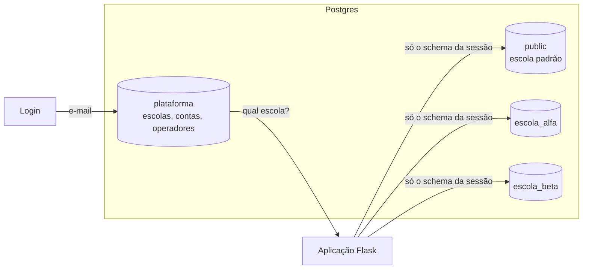

# Várias escolas no mesmo servidor

O EducaFast atende várias escolas com **uma aplicação e um banco Postgres**. Cada escola tem a própria área no banco (um *schema*) e só enxerga os próprios dados.

## Perfis

| Perfil | Quem é | O que faz |
| --- | --- | --- |
| ADM Supremo | Dono da plataforma | Cria escolas e o superadmin de cada uma, acompanha os totais e desativa ou reativa o acesso de uma escola |
| Superadmin (superperfil) | Direção da escola | Define regras, identidade e usuários da própria escola |
| Administrador, professor e aluno | Pessoas da escola | Usam o sistema dentro da escola a que pertencem |

O ADM Supremo **não** é usuário de nenhuma escola: ele vê quantos alunos e professores cada escola tem, mas não entra nas telas internas delas.

## Como o banco fica organizado



- **`plataforma`**: lista de escolas, diretório de logins (cada e-mail pertence a uma única escola) e os ADMs Supremos.
- **`public`**: a escola padrão. Uma instalação antiga, de uma escola só, continua funcionando sem mudança.
- **`escola_<código>`**: uma área por escola criada no Painel Supremo, com as mesmas tabelas da escola padrão.

## Como uma requisição encontra a escola certa

1. No login, o e-mail é procurado no diretório `plataforma.contas`, que diz de qual escola ele é.
2. A sessão (e o token JWT, no campo `esc`) guarda o schema dessa escola.
3. Toda consulta passa por `get_session()`, que aplica o `schema_translate_map` do SQLAlchemy: as tabelas da aplicação passam a apontar para o schema da escola. O código das telas não precisa saber em que escola está.
4. A cada requisição, a aplicação confere se a escola continua ativa. Escola desativada tem a sessão encerrada na hora.

O diretório de logins se mantém sozinho: criar, renomear ou excluir um usuário atualiza `plataforma.contas` na mesma transação. Um e-mail já usado em outra escola é recusado.

Os arquivos enviados também ficam separados: a escola padrão usa a pasta de uploads e as outras usam `uploads/escolas/<schema>`.

## Criar uma escola

Pelo Painel Supremo (`/supremo`), informe nome, código, e-mail e senha do superadmin. A criação do schema, das tabelas e do superadmin acontece **numa única transação**: se qualquer passo falhar, nada fica criado. O código aceita só letras minúsculas, números e hífen, e é validado antes de virar nome de schema.

Para criar o primeiro ADM Supremo de uma instalação nova:

```bash
flask --app app criar-operador
```

No ambiente de demonstração (`iniciar-educafast`), o ADM Supremo `supremo@teste.local` já é criado com a mesma senha dos outros usuários de teste.

## Testes

`api/tests/test_multiescola.py` cobre o isolamento entre escolas (usuários e comunicados), o e-mail único na plataforma, códigos inválidos ou maliciosos, escola desativada, o token JWT e as pastas de upload. Esses testes só rodam no Postgres de testes, porque o SQLite não tem schemas; no SQLite a aplicação funciona como escola única.

## Limites conhecidos

- Todas as escolas dividem o mesmo servidor e o mesmo Postgres: um problema no servidor afeta todas.
- Backup e restauração de uma escola isolada exigem `pg_dump --schema=escola_<código>`; ainda não há botão para isso.
- Excluir uma escola de vez não está disponível no painel, de propósito: desativar bloqueia o acesso sem apagar dados.
